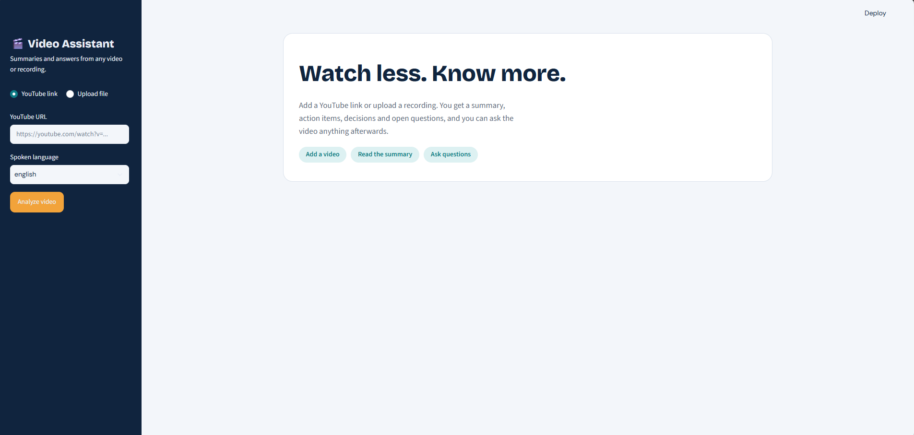
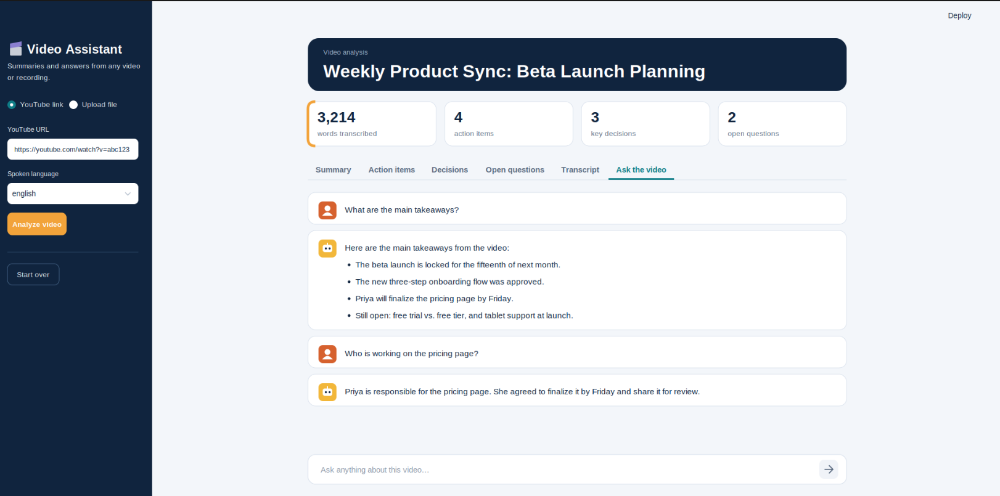
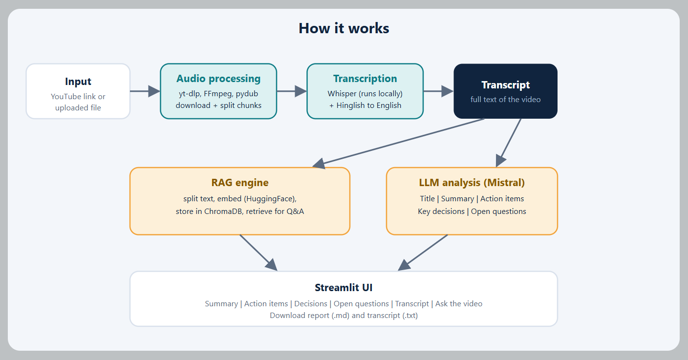

# 🎬 AI Video Agent

**Watch less. Know more.**

Turn long YouTube videos, lectures, podcasts, and meeting recordings into summaries, action items, key decisions, and searchable knowledge — powered by AI.

<p align="center">
  
</p>

<p align="center">
  
  
  
  
  
</p>

## ✨ Features

- 🎥 **Video & Audio Input:** YouTube links or uploaded media files.
- 🎙️ **Speech Transcription:** Local Whisper transcription with English and Hinglish support.
- 📝 **AI Summaries:** Generate concise summaries, action items, decisions, and open questions.
- 💬 **Chat with Videos:** Ask questions about the transcript using Retrieval-Augmented Generation (RAG).
- 🔎 **Semantic Search:** Retrieve relevant transcript chunks using embeddings and ChromaDB.
- 📥 **Export Results:** Download summaries and transcripts.

## 🖼️ Project Screenshots

<!-- Add screenshots of your actual Streamlit application in docs/screenshots/ -->

<p align="center">
  
</p>

<p align="center">
  
</p>

> Replace these placeholder images with screenshots of your running application.

## ⚙️ How It Works

<p align="center">
  
</p>

1. **Input:** Upload a media file or provide a YouTube URL.
2. **Transcription:** Whisper converts speech into text.
3. **Analysis:** A Mistral LLM generates summaries and structured insights.
4. **Indexing:** LangChain, sentence-transformers, and ChromaDB build the RAG pipeline.
5. **Question Answering:** Retrieve relevant transcript chunks to answer user questions.

## 🛠️ Tech Stack

| Component | Technologies |
|---|---|
| Frontend | Streamlit |
| Transcription | OpenAI Whisper, PyTorch |
| LLM | Mistral AI |
| Orchestration | LangChain |
| RAG & Vector Store | Sentence Transformers, ChromaDB |
| Media Processing | yt-dlp, FFmpeg, pydub |

## 🚀 Getting Started

**1. Clone the repository**

```bash
git clone https://github.com/garry000111/video-agent.git
cd video-agent
```

**2. Create a virtual environment**

```bash
python -m venv .venv
```

Windows PowerShell:

```powershell
.venv\Scripts\Activate.ps1
```

**3. Install dependencies**

```bash
pip install -r requirements.txt
```

Install FFmpeg separately and ensure it is available on your PATH.

**4. Configure your API key**

Create a `.env` file in the project root:

```env
MISTRAL_API_KEY=your_api_key_here
```

Never commit your real API key.

**5. Run the application**

```bash
streamlit run app.py
```

Open the local URL displayed in your terminal.

## 💡 Use Cases

- Summarize lectures and educational videos.
- Extract action items from meetings.
- Search long podcasts and interviews.
- Ask questions about recorded discussions.

## 🗺️ Future Improvements

- [ ] Timestamp-based answers
- [ ] PDF report export
- [ ] Speaker identification
- [ ] Docker deployment
- [ ] Support for more languages

## 📄 License

No license has been added yet.

---

<p align="center">Built with ❤️ using Python, Whisper, LangChain, Mistral AI, and ChromaDB.</p>
